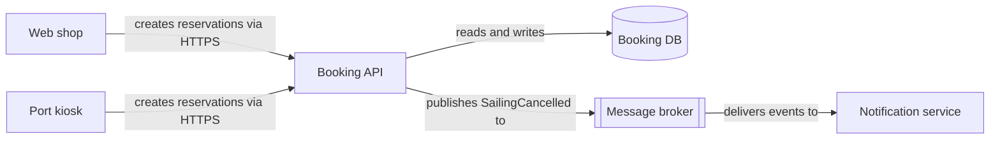

# Step R7 — Can every reader get the same meaning, whatever their sight, device or working language?

Accessible artefacts are better for everyone: a diagram that does not rely on colour also survives a mono printer, a washed-out beamer and a compressed video call. This step applies the parts of WCAG that bear on architecture diagrams and documents, plus cognitive and language accessibility. It is a communication check, not a conformance audit; say so when an organisation needs formal conformance.

Grounding: W3C WCAG 2.2 (W3C Recommendation; the success criteria listed below), W3C WAI tutorials on complex images, the SVG `<title>` and `<desc>` elements, Mermaid's `accTitle` and `accDescr` keywords, the Okabe–Ito colour-universal-design colour set, and MIKA's text alternative pattern and accessibility gate below.

## WCAG 2.2 success criteria that matter most here
| SC | Level | What it requires | How it shows up in architecture artefacts |
|---|---|---|---|
| **1.1.1 Non-text Content** | A | Text alternative for non-text content | Diagram images in docs, wiki platforms and slides need an alternative that conveys the same information (pattern below) |
| **1.3.1 Info and Relationships** | A | Structure conveyed visually is also available programmatically or in text | Groupings and relationships in a diagram exist in the text alternative; documents use real headings, lists and tables, not bold lines |
| **1.3.3 Sensory Characteristics** | A | Instructions do not rely only on shape, colour, size, position or sound | "See the red box on the right" fails; "see the Lab results gateway (red, right)" passes |
| **1.4.1 Use of Color** | A | Colour is not the only visual means of conveying information | Status, ownership, environment or risk shown by fill alone |
| **1.4.3 Contrast (Minimum)** | AA | Text contrast at least 4.5:1, or 3:1 for large text (about 18 pt, or 14 pt bold) | Labels on coloured fills; grey text on white; text on photos |
| **1.4.5 Images of Text** | AA | Use real text rather than images of text where possible | Screenshot of a table or of code in a doc; exported flat image export diagrams that cannot be searched or enlarged cleanly |
| **1.4.10 Reflow** | AA | Content usable at 320 CSS px width without two-dimensional scrolling (diagrams and data tables are allowed exceptions) | The diagram may be exempt; its text alternative and the surrounding document are not |
| **1.4.11 Non-text Contrast** | AA | Graphical objects needed to understand content have at least 3:1 contrast against adjacent colours | Thin pale lines, light-grey borders, pastel fills that separate groups |
| **2.4.6 Headings and Labels** | AA | Headings and labels describe topic or purpose | "Overview 2" or "Misc" as headings; boxes named "Service A" |
| **3.1.4 Abbreviations** | AAA | A mechanism for the expanded form of abbreviations | Not required at AA, but expanding abbreviations on first use and linking a glossary is cheap and helps every reader |

AAA criteria are good practice, not a baseline. Do not tell an author they "fail WCAG" on an AAA criterion.

## Colour without dependence
About 1 in 12 men and 1 in 200 women of Northern European ancestry have some form of colour blindness, most often affecting the red and green range. Add bright rooms, sunlight, and grey-scale printing, and colour becomes unreliable for everyone.

Check, for every meaning carried by colour, that a second cue carries it too:
- **Text**: a tag in the label "(new)", "(retiring)", "[PII]".
- **Shape or border**: thick border for changed, dashed border for planned, double border for external.
- **Pattern** (hatching) for areas in print.
- **Position or grouping**: all retiring elements in one labelled region.

Colour set advice:
- Use few colours, each with one meaning (`08` on colour discipline).
- Avoid pairing the two hues most often confused for opposite meanings. Blue with orange is safer.
- The Okabe–Ito colour set (black #000000, orange #E69F00, sky blue #56B4E9, bluish green #009E73, yellow #F0E442, blue #0072B2, vermillion #D55E00, reddish purple #CC79A7) was designed to stay distinguishable for common colour vision deficiencies. Check contrast still: yellow and sky blue are too pale for lines or text on white.
- Check in grey-scale: if two meanings collapse into the same grey, add a second cue.

## Contrast checks
- Text on fills: compute the ratio (any contrast checker built on the WCAG formula). Dark text on pale fills usually passes; white text on mid-tones often does not.
- Lines and borders against background: at least 3:1 when the line is needed to understand the diagram.
- Adjacent fills that separate groups: at least 3:1, or add a border that meets 3:1.
- Remember the medium (`02`): large screens in lit rooms and video compression reduce effective contrast. Aim above the minimum.

## The MIKA text alternative pattern
A good alternative for an architecture diagram is structured, not a one-line image description. Use a brief image label that points to a longer description placed next to the image (or in a `
` block, an SVG `<desc>`, or Mermaid's `accDescr`).

1. **Title and type**: "VetFlow — container view — clinical records (as of October 2026)."
2. **Summary**: one or two sentences with the key message.
3. **Elements**: a list grouped as in the diagram, each with name, type and responsibility.
4. **Relationships**: "Booking service → reserves slot in → Clinic calendar store [SQL]." One line each, in a consistent direction matching the key.
5. **Boundaries and groupings**: trust zones, environments, ownership.
6. **Status and encodings**: what is new, changing or retiring.
7. **Omissions**: what the view leaves out on purpose.

Diagrams-as-code help: the source (DSL or diagram code) is already a structured text form, and a list of relationships can often be generated from the model (`10`). Raw code is not a substitute for a description for most readers, but it is a valuable extra.

Mermaid example:

## Readable size
- Diagram labels at least as large as the document's body copy when displayed at its intended size; see medium limits in `02`.
- Provide vector (SVG) exports so readers can enlarge without blur.
- Do not shrink a large diagram to fit a page; split it (`05`).

## Cognitive and language accessibility
- One message per view and a stated purpose (`03`) reduce load for every reader, and especially for readers with attention or memory difficulties.
- Consistent placement: the same element in the same position across related views.
- Plain language, brief sentences, abbreviations expanded on first use, and a glossary (`09`).
- Predictable structure: the same section order across decision records and design docs.
- Avoid animation that cannot be paused; avoid flashing.
- Readers working in a second language benefit from literal wording: "the service stops accepting requests" rather than "the service falls over".

## Accessible formats and environments
- Publish in formats readers can open without paid tools, that support enlargement and screen readers: HTML or plain-text pages, tagged PDF, SVG with text.
- Keep diagram source editable so alternatives can be updated with the diagram.
- In meetings: share materials beforehand, describe what is on screen aloud, turn on captions, and accept written input from people who prefer not to speak live.

## MIKA accessibility gate (A1–A6)
| # | Gate | Fail when |
|---|---|---|
| A1 | No colour-only meaning | Any meaning carried by colour alone (SC 1.4.1) |
| A2 | Text contrast | Any label below 4.5:1 (3:1 large) (SC 1.4.3) |
| A3 | Graphic contrast | Lines, borders or group fills needed for meaning below 3:1 (SC 1.4.11) |
| A4 | Text alternative | A diagram used in a document or slide has no equivalent description (SC 1.1.1) |
| A5 | Real structure | Document uses visual formatting instead of headings, lists, tables; or images of text (SC 1.3.1, 1.4.5) |
| A6 | Plain, expanded language | Undefined abbreviations or figures of speech in an artefact for mixed or international readers |

Severity: A1 failing on information that drives a decision or a safety or security judgement → High; elsewhere Medium. A4 on a published or externally shared document → High; internal draft → Medium. A2/A3 → Medium unless the text cannot be read at all in the medium (then High).

## House examples
- *GridShare* roadmap colours projects green/amber/red by health with no other cue, shown to the member assembly to choose which project to fund. A1 fails on a decision. Finding: High, Accessibility. Fix: add "On track / At risk / Blocked" text tags and border styles; check 3:1 for borders.
- *VetFlow* wiki embeds a flat image export of the container view with the image label "architecture diagram". A4 fails on an onboarding page. Fix: structured description using the pattern above; link the Structurizr source.

## Review checks for this step
Run A1–A6. Note which items could not be checked from the input (a prose description hides colours and sizes) and lower confidence accordingly.

## In `draft` mode
Fill ACCESSIBILITY with: the text alternative (pattern above, or `accTitle`/`accDescr` in Mermaid), the second cue for each colour meaning, and a contrast note.
