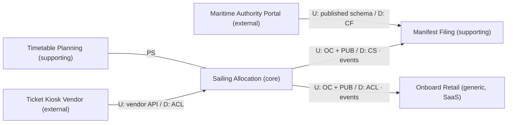

# Relating: how do contexts depend on each other?

Contexts exchange data and trigger each other. A relationship map records whose model influences whose, how the teams coordinate, and where meaning is converted. Every relationship has two faces, a team arrangement and a technical integration; Gaia chooses for both.

Grounding: the relationship pattern names from Evans' *DDD Reference* (CC-BY 4.0); the DDD-Crew *Context Mapping* cheat sheet (CC BY-SA 4.0), which groups team relationships as mutually dependent, upstream/downstream and free, and uses short codes on map edges; the public Enterprise Integration Patterns catalogue for translator and aggregator mechanics. The "Terms & Distance" selection guide, the translation-cost score and the examples are MIKA's.

## Pattern codes used in this file
| Code | Pattern | One-line commitment |
|---|---|---|
| PS | Partnership | Two teams plan integration together and fix breakages together |
| SK | Shared kernel | A small, co-owned piece of model; changes need both teams |
| CS | Customer–supplier | Upstream plans for downstream's needs on an agreed schedule |
| CF | Conformist | Downstream adopts the upstream vocabulary unchanged |
| ACL | Anticorruption layer | Downstream converts incoming concepts into its own at the edge |
| OC | Open contract (Evans: open-host service) | Upstream offers a consumer-oriented contract decoupled from its internals |
| PUB | Published language | A documented, versioned exchange schema (OpenAPI, AsyncAPI, an industry format) |
| SW | Separate ways | No integration; each side solves its own need |
| BBoM | Big ball of mud | A legacy area with no clear model, to be fenced off |

## Who is upstream?
The **upstream** side's model and schedule influence the **downstream** one; upstream changes can break downstream. The direction of data flow does not decide this. Ask: "If these two disagree about a field, whose version wins?"

## The MIKA "Terms & Distance" guide
Two questions settle most choices.

**Question 1 — Who sets the terms?** (power and dependency)
- **Mutual**: both teams depend on each other and can change the other's plans (DDD-Crew: mutually dependent).
- **Negotiable**: downstream depends on upstream, and upstream will listen and plan for downstream.
- **Fixed**: upstream will not or cannot adapt (an external vendor, a regulator's format, a legacy system with no team).
- **None**: no real dependency is needed (DDD-Crew: free).

**Question 2 — How far apart are the models?** (translation distance)
- **Same**: the shared concept is genuinely identical on both sides.
- **Near**: same concepts, different names or shapes; a field-by-field mapping does it.
- **Far**: different concepts; combining, splitting or remembering state is needed to convert.

### Selection grid
| Who sets the terms ↓ / Distance → | Same | Near | Far |
|---|---|---|---|
| **Mutual** | SK, kept tiny | PS | PS with a written contract, or re-check the boundary (`05`) |
| **Negotiable** | CS; downstream may conform | CS + PUB | CS + ACL downstream |
| **Fixed** | CF | CF for non-core consumers, else ACL | ACL, or SW if the value is below the cost |
| **None** | SW | SW | SW |

Overrides, applied after the grid:
1. **Core downstream.** A core context (`04`) never conforms unless distance is *Same*; protect it with an ACL.
2. **Many consumers.** If upstream serves three or more downstreams, it offers an OC with a versioned PUB, whatever the grid says for each pair.
3. **Bought products.** Integrating SaaS is *Fixed* by definition; put the translation on your side.
4. **Duplicating is cheaper.** If rebuilding the needed function costs less than a year of integration upkeep, and the function is not core, choose SW.

### Translation cost score
When unsure between CF, ACL and SW, score the cost of conversion (0–2 each):
- Concepts to map (0: ≤3, 1: 4–10, 2: >10).
- Upstream change rate (0: yearly, 1: quarterly, 2: monthly).
- Memory needed (0: per message, 1: lookups, 2: aggregation over time).
Total 0–2: conform or map inline. 3–4: a dedicated ACL. 5–6: question whether the integration is worth it; consider SW or a different upstream.

## What each choice costs and when it decays
- **PS** works while teams talk often and share goals. It decays when teams grow apart or move time zones; then formalise as CS.
- **SK** must stay small: value types and contracts, never entities with behaviour. Useful briefly while splitting a legacy model; replace with a PUB once owners differ.
- **CS** puts downstream's requirements into upstream's backlog. It ends in SW if priorities diverge for good.
- **CF** is cheap, but upstream's words and changes leak in. Move to ACL once the consuming side turns into a differentiator.
- **ACL** costs code and buys a clean model.
- **OC** lets upstream change internals freely; it may run two contract versions in parallel while consumers migrate. OC and ACL combine well: a clean contract upstream, and a thin layer of its own in a core downstream.
- **SW** is never right for core logic: duplicated core rules split the advantage.
- **BBoM** areas get ACLs on every edge until they are replaced.

### Worked example: regional ferry operator
| Pair (upstream → downstream) | Terms | Distance | Grid | Override | Result |
|---|---|---|---|---|---|
| Vendor ticket kiosks → Sailing Allocation | Fixed | Far | ACL | Core downstream | ACL |
| Sailing Allocation → Manifest Filing | Negotiable | Near | CS + PUB | — | CS + PUB |
| Maritime authority portal → Manifest Filing (data flows to the authority, but its format wins) | Fixed | Near | CF | Not core | CF to the authority's schema |
| Timetable Planning ↔ Sailing Allocation | Mutual | Near | PS | — | PS |
| Sailing Allocation → Onboard Retail, Freight Billing, Passenger App | Negotiable | Near | — | Many consumers | OC + PUB |
| Crew Rostering ⟂ Onboard Retail | None | — | SW | — | SW |

## How do the teams work together day to day?
The pattern says who adapts; the team interaction says how often people talk. Team Topologies names three interaction modes, which map onto the guide like this:
| Terms | Usual interaction mode | What it looks like |
|---|---|---|
| Mutual | Collaboration, time-boxed | Shared planning, joint backlog items, pairing across teams for a few sprints |
| Negotiable | X-as-a-service | Upstream runs its contract like a product: roadmap, changelog, support channel |
| Fixed | X-as-a-service (one-way) | Downstream reads vendor or regulator docs; no influence on the roadmap |
| None | — | No standing interaction |
A long-running collaboration with no end date is a smell: either the boundary is wrong (`05`) or the teams should merge.

## How is a contract kept safe as both sides change?
- **Describe it.** Synchronous contracts in OpenAPI 3.1; event contracts in AsyncAPI 3.0 with schemas (JSON Schema, Avro or Protobuf) in a registry.
- **Test it from the consumer side.** Consumer-driven contract tests (for example with Pact) let each downstream state what it relies on; upstream's build fails if a change breaks a consumer.
- **Version it.** Additive changes in place; breaking changes as a new major version run in parallel. Announce retirement dates (the HTTP `Sunset` header, RFC 8594, for APIs; a deprecation field in the event catalogue for events).
- **Own it.** Every published contract has one owning team, named in the relationship map and in the knowledge graph (`10`).

## Where does conversion live, and does it need memory?
- **Per-message conversion**: map each request or message on its own, in code at the edge, in a gateway for synchronous calls, or in a message translator for asynchronous ones.
- **Conversion with memory**: needed when many fine-grained upstream messages make one meaningful downstream fact (the EIP aggregator), when data from several upstreams must be joined, or when several sources should look like one. Use a small store plus a translator, or a stream processor.
- If several downstreams write the same conversion, move it upstream into the OC.

## Calls or events?
Patterns describe ownership, not transport. Prefer published events when downstream *reacts* to something upstream did. Use synchronous queries when downstream needs data at that moment and has a fallback if upstream is down. Event design is in `09`; broker and streaming infrastructure is **Nereus**'s remit.

## Drawing the map
Show every context, every relationship, the code on each end, and U/D markers. Annotate the core. Mermaid has no native notation for this; use a flowchart with labelled edges, plain identifiers and quoted labels.

Arrow from upstream to downstream; undirected line for PS or SK; label gives the code on each side and calls or events.

Text form for model output:
`Sailing Allocation → Manifest Filing — OC + PUB / customer side — events — manifest must not depend on allocation internals` — in real output, expand every code to its full pattern name

## Keeping the map alive
- Store it in the repository next to decision records, ideally as a file (a context-mapping DSL, YAML or Mermaid) that the knowledge graph in `10` can read; change it in the same pull request as the relationship.
- Each team owns its own edges; an architecture role keeps the overview.
- A hand-drawn current map beats a generated stale one.
- The map shows structure, not runtime volumes or behaviour; treat it as a conversation tool.
