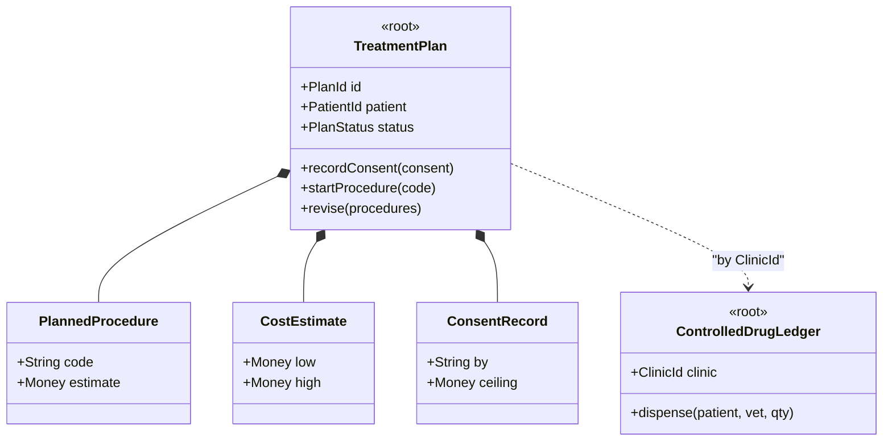

# Detailing: designing the units that protect the rules

Use for areas whose build shape (`07`) is *behavioural model* or *hybrid*. Here Gaia turns rules and vocabulary into code-level units: things with identity, value types that never change, consistency units (aggregates) and stateless domain operations.

Grounding: the building-block patterns (entity, aggregate, repository, factory, domain service, domain event, and the value-object pattern) from Evans' *DDD Reference* (CC-BY 4.0); the DDD-Crew canvas for designing aggregates (CC BY-SA 4.0); Fowler's bliki entries on value types and on aggregates. The sizing questions, the rule-placement table and the examples are MIKA's.

## Where does each rule belong?
Start from the rules collected in intake and workshops (`01`, `02`), not from nouns. For each rule ask where it can be checked with the least data.

| The rule needs… | Put it in | Ferry example |
|---|---|---|
| One value only | A value type's constructor | Lane-metres must be positive and ≤ 200 |
| Several values that travel together | A value type's method | `HeightClass.fitsDeck(deck)` |
| State of one thing over its lifetime | That thing's entity, inside its aggregate | A hold can be confirmed only while active |
| Several things kept consistent at commit time | One aggregate around all of them | Holds on a sailing never exceed free lane-metres |
| Several aggregates, but "soon" is fine | A policy reacting to events, or a coordinator (`09`) | Release holds when a sailing is cancelled |
| A calculation using several aggregates or outside data | A domain service | Fare quote from route, season and vehicle class |

The rule-to-unit mapping is the design. If a rule has no home, the model is incomplete.

## Value types: small, immutable, self-checking
A value type (Evans: value object) has no identity: two instances with the same values are interchangeable.
- Examples: `Money(amount, currency)`, `LaneMetres`, `HalfHourInterval`, `MicrochipNumber`, `KilowattHours`, `DateRange`.
- **Immutable**: operations return new instances (`range.extendBy(days)`), so they can be shared safely.
- **Valid on creation**: an interval whose end is before its start cannot be constructed.
- **Carry behaviour**: `DateRange.overlaps(other)`, `Money.add(other)` that refuses mixed currencies.
- **Compared by value.**

Lean on them heavily. Using bare strings and decimals everywhere ("primitive obsession") scatters validation and lets invalid states in. A model with many small value types and few entities is usually healthy.

## Things with identity
An entity keeps its identity while its attributes change: a dog is the same patient after a change of owner, weight and microchip registry.
- Identity is explicit: generated by the domain, by the store, or a natural key that never changes (rarer than people think).
- State changes only through business operations (`patient.recordWeight(kg)`), never public setters.
- Entities live inside an aggregate; they are not loaded and changed on their own across transactions.

## Aggregates: consistency units
An aggregate groups an entity (the **root**) with the inner entities plus value types that must change together, so that its rules hold after every command.

### Six working rules
1. **The rules decide the edge.** Everything needed to check a rule at commit time is inside; nothing else is.
2. **One aggregate per transaction.** A command alters exactly one instance. Others follow through events (eventual consistency).
3. **Only the root is reachable.** Outside code holds the root; inner entities are not handed out for modification.
4. **Refer to other aggregates by ID.** No object references across edges; this keeps loads small and edges visible.
5. **Guard concurrency on the aggregate.** Optimistic locking with a version number is the default; a stale write is rejected and retried.
6. **Speak the vocabulary.** Methods are business commands (`reserve`, `confirm`, `recordConsent`) that validate, change state and raise events.

### How small is small enough?
Ask these in order:
1. "If these two things are out of step for a few seconds, does anything bad happen?" No → separate aggregates.
2. "Is this a *read* need or a *consistency* need?" Showing vessel details next to a hold is a read need; it does not put the vessel inside the hold.
3. "Does any collection inside grow without limit?" A patient with every visit ever recorded will not scale. Bucket by period, or make the growing items their own aggregates.
4. "How many users hit the same instance at once?" A single `Sailing` aggregate taking every booking on a holiday Friday will contend; split capacity into per-deck or per-lane-group units if the rule allows.

### Worked example: veterinary clinic network (Clinical Care)
**Aggregate `TreatmentPlan`** (root)
- Value types: `CostEstimate(Money low, Money high)`, `ConsentRecord(by, at, ceiling)`, `PlanStatus`.
- Entities: `PlannedProcedure` (code, estimated cost, status).
- Rules: no procedure starts unless consent covers the running total; status moves `Drafted → Consented → InProgress → Completed`, or `Withdrawn` before `InProgress`; a revision above the consented ceiling returns the plan to `Drafted`.
- Commands: `draft`, `recordConsent`, `startProcedure`, `completeProcedure`, `revise`, `withdraw`.
- Events: `TreatmentPlanDrafted`, `OwnerConsentRecorded`, `ProcedureStarted`, `PlanRevisedAboveConsent`, `TreatmentPlanCompleted`.

**Aggregate `ControlledDrugLedger`** (Pharmacy Stock, one per clinic and substance)
- Rule: recorded balance never negative; every withdrawal names a patient and a vet.
- Commands: `receive`, `dispense`, `recordWastage`. Events: `ControlledDrugDispensed`, `StockDiscrepancyFound`.

Coordination: `ProcedureStarted` triggers a dispensing request; a `StockDiscrepancyFound` event raises a hot alert rather than blocking surgery. That cross-aggregate flow belongs to `09`.

### Mermaid template (classDiagram)

Composition (`*--`) for parts inside the aggregate; dashed dependency (`..>`) for ID references to other aggregates. Plain identifiers, quoted labels, no styling.

## Using the DDD-Crew canvas as a checklist
For every aggregate in a core area, the canvas asks for: name and description; state transitions; enforced rules; corrective policies (what happens when a rule is broken eventually rather than immediately); handled commands and created events; throughput (commands per second, concurrent users per instance); size (event growth rate, lifetime). Throughput and size are the questions most often skipped and most often fatal.

## Stateless domain operations
A domain service holds logic that belongs to the business but to no single entity or value type, usually because it reads several aggregates or an outside calculation: `FareQuoter`, `SurplusMatcher`.
- Name it in the vocabulary; no "Manager", "Helper", "Processor".
- It may read several aggregates; it must not change several in one transaction.
- Do not confuse it with an **application service**, which runs a use case: load the aggregate, call the command, save, publish, handle transaction and authorisation.

## Getting aggregates in and out of storage
- **Repository**: a collection-like port defined in the domain (`TreatmentPlans.get(id)`, `save(plan)`), implemented by an adapter. One per root, never for inner entities.
- **Factory**: wraps non-trivial creation, such as building a `TreatmentPlan` from a triage outcome. Often a static method on the root.

## Signs the model is working, or not
Working: an expert can read where a rule lives; changing a rule touches one aggregate; invalid states cannot be constructed. Not working: objects with only getters and setters while services hold every rule; aggregates spanning half the schema; events named after table operations.

## What goes into the model template
For every aggregate in a core area: its root, inner entities plus value types, rules, commands, events. Then list the events and draw a classDiagram. Detail only core areas; for others list the main records.
